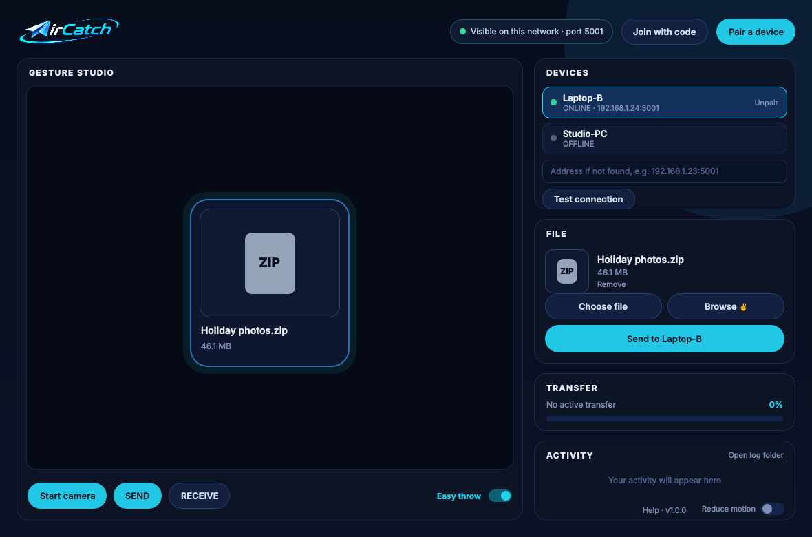
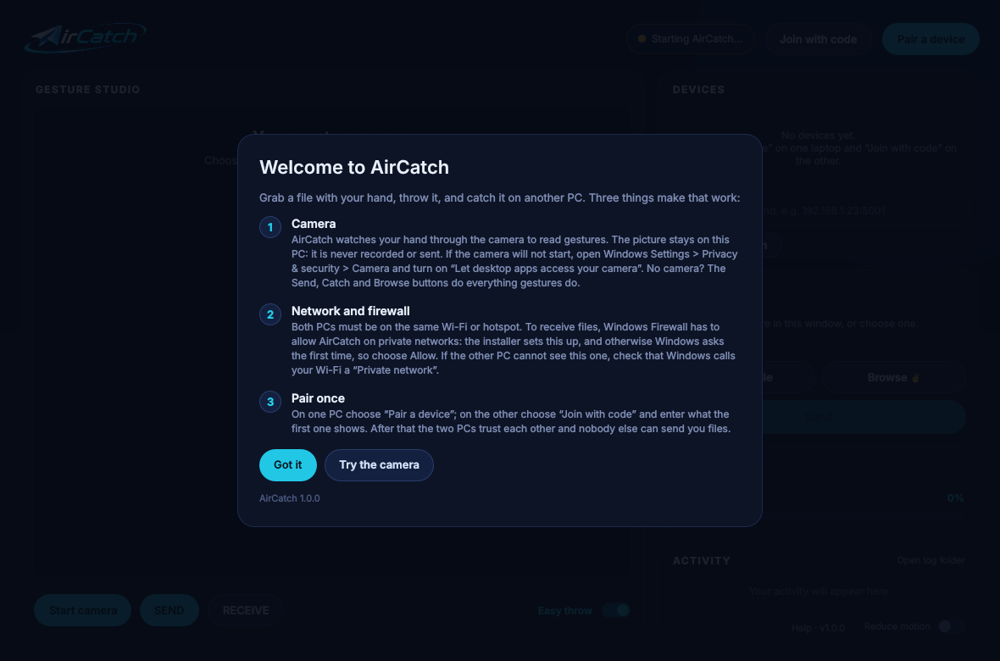

<p align="center">
  
</p>

# AirCatch

**Grab a file out of the air on one PC, throw it, and catch it on another.**

AirCatch is a Windows app that sends files between computers on the same Wi-Fi using hand
gestures read by the webcam. Make a fist to pick a file up, flick your hand open to throw it, and
catch it on the other PC by closing and opening your hand. Every gesture also has a button, so it
works without a camera too.



## What it does

- **Gesture transfer.** Open palm, fist, throw on the sender; fist, open on the receiver.
- **Gesture file explorer.** A peace sign opens it; swipe up and down to move, right to open a
  folder, left to go back; pinch to pick a file. A small indicator shows when the next swipe will count.
- **Finds devices by itself** on the local network (mDNS). No accounts, no cloud, no internet needed.
- **Pair once.** One PC shows a one-time code, the other pastes it in. After that only paired
  devices can send you files.
- **Encrypted and checked.** TLS 1.3 with certificates on both sides; every file is verified with
  SHA-256 before it is saved. See [Security](#security).
- **Large files.** Files are streamed, not loaded into memory (limit 10 GB per file).

## Install (Windows 10 or 11, 64-bit)

1. Open the [latest release](../../releases/latest).
2. Download **`AirCatch-Setup-<version>.exe`** and run it.
   Or download **`AirCatch-<version>-windows-portable.zip`**, unzip it anywhere and run `AirCatch.exe`
   (nothing is installed).
3. Start AirCatch from the Start menu or the desktop shortcut. You do **not** need Python.

> **Windows will warn you about the installer.** AirCatch is not code-signed (a certificate costs
> money), so Windows SmartScreen shows "Windows protected your PC". Choose **More info**, then
> **Run anyway**. To be sure the file is the one published here, compare its SHA-256 with
> `SHA256SUMS.txt` from the release: `Get-FileHash .\AirCatch-Setup-<version>.exe`.

You need a webcam for gestures (30 frames per second or better works best), and both PCs on the
same Wi-Fi or hotspot.

## First use



1. **Camera.** Press **Start camera**. If it does not start, open *Windows Settings > Privacy &
   security > Camera* and turn on *Let desktop apps access your camera*. The picture never leaves
   your PC and is never recorded.
2. **Firewall.** The installer allows AirCatch through Windows Firewall on **private** networks.
   With the portable version Windows asks the first time: choose **Allow**. Windows must call your
   Wi-Fi a *Private network* (Settings > Network & internet > your Wi-Fi > Private network).
3. **Pair.** On one PC choose **Pair a device** and copy the code it shows. Get the code to the other
   PC (a chat message or e-mail to yourself is fine: it works once, for two minutes), choose **Join
   with code** there and paste it. Approve the request on the first PC.
4. **Send.** Choose a file (or open the gesture explorer), pick the device, then **Send** or grab and
   throw. On the other PC press **Catch** or close and open your hand.

### Gestures

| Where | Gesture | What happens |
|---|---|---|
| Sending | Open palm, then fist | Picks up the chosen file |
| Sending | Flick the fist open quickly | Throws the file to the selected device |
| Sending | Open the fist gently | Puts the file down (nothing is sent) |
| Receiving | Fist, then open hand | Catches the file being offered |
| Sending | Peace sign, held for a moment | Opens the file explorer |
| Explorer | Swipe up / down | Moves the highlight |
| Explorer | Swipe right / left | Opens a folder / goes back |
| Explorer | Pinch (thumb and index), held about half a second | Picks the file or opens the folder |
| Explorer | Peace sign | Closes the explorer |

Tips: swipe from the middle of the picture, bring your hand back, and wait for the green **READY**
indicator before the next swipe. Good light matters: in dim light the camera blurs fast movements.
Details and tuning: [docs/gestures.md](docs/gestures.md).

## Something not working?

See [docs/troubleshooting.md](docs/troubleshooting.md): devices that cannot see each other, the
camera not starting, the firewall, missed gestures, and where the log files are.

## Security

- Devices are paired with a one-time code; after that each side accepts only the exact certificate
  it paired with. Everything is encrypted with TLS 1.3.
- A file is saved only after its SHA-256 matches. Nothing is overwritten, and file names from the
  other device are cleaned before use.
- AirCatch never runs a received program, and marks received files as coming from another computer
  so Windows warns before you run them.
- Known limits, stated plainly: the app is **not code-signed**, it has had **no independent security
  audit**, and the device's private key is stored unencrypted in your Windows user profile.

More: [SECURITY.md](SECURITY.md) (how to report a problem), [docs/security.md](docs/security.md)
(the design) and [docs/milestone-10.md](docs/milestone-10.md) (the self-audit: what was tested,
found and fixed).

## Status

Version 1.0.0. Honest notes on how far it has been tested:

- The automated tests (700+) cover transfer, pairing, security, the gesture engine and the app
  logic, and run on Windows and Linux.
- Gesture recognition was tuned mostly on simulated hand movements and on one developer's webcam.
  Your camera, lighting and hands may behave differently; [docs/gestures.md](docs/gestures.md)
  explains how to record your own movements and tune it.
- Transfers have been used between two Windows laptops on a home network. It has not been tested on
  large or managed networks (offices, universities), which often block device discovery.
- Windows only for now. The code runs on Linux for development, but there is no Linux or macOS package.

## Run from source (for developers)

Python **3.11** on Windows:

```powershell
git clone <this repository>
cd aircatch
python -m venv .venv
.venv\Scripts\Activate.ps1
pip install -r requirements.txt
python run.py
```

Run the tests with `python -m pytest`. Two copies on one PC, for trying things without a second
computer:

```powershell
python run.py --config-dir devices\A --name Laptop-A --download-dir devices\A\inbox --port 5001
python run.py --config-dir devices\B --name Laptop-B --download-dir devices\B\inbox --port 5002
```

Other tools: `python gesture_demo.py` (a hand-tracking test window), `python gesture_record.py`
(records your gestures for tuning), `python transfer_cli.py` (transfers from the command line),
`python transfer_bench.py` (speed test).

> `requirements.txt` deliberately excludes **PySide6 6.12.0**: on Python 3.11 it crashes the app
> within seconds. See [docs/troubleshooting.md](docs/troubleshooting.md#for-developers).

### Build the installer

```powershell
pip install pyinstaller
winget install JRSoftware.InnoSetup        # once
powershell -ExecutionPolicy Bypass -File packaging\build.ps1
```

This makes `dist\installer\AirCatch-Setup-<version>.exe` and the portable zip, and starts the
packaged program to check that it can open its window, track a hand, pair and transfer. Pushing a
tag such as `v1.0.0` makes GitHub build and publish the same files
([.github/workflows/release.yml](.github/workflows/release.yml)). The full packaging notes are in
[docs/milestone-11.md](docs/milestone-11.md).

### How it is put together

| Part | Folder | What it does |
|---|---|---|
| App window | `src/aircatch/ui` | Qt Quick (QML) interface, the controller, camera thread, file explorer |
| Gestures | `src/aircatch/gestures` | MediaPipe hand tracking, pose classifier, swipe detector, gesture state machine |
| Transfer | `src/aircatch/transfer` | The wire protocol, sender and receiver ([docs/protocol.md](docs/protocol.md)) |
| Security | `src/aircatch/security`, `src/aircatch/pairing` | Device identity, TLS, trust list, pairing |
| Discovery | `src/aircatch/discovery` | Finding devices on the network ([docs/discovery.md](docs/discovery.md)) |
| Packaging | `packaging` | PyInstaller recipe, Inno Setup script, build script |

Built with Python, PySide6 (Qt), OpenCV, MediaPipe, `cryptography` and `zeroconf`.

## License

No license has been chosen yet. Until a `LICENSE` file is added, the code is published for reading
and all rights are reserved by the author.
